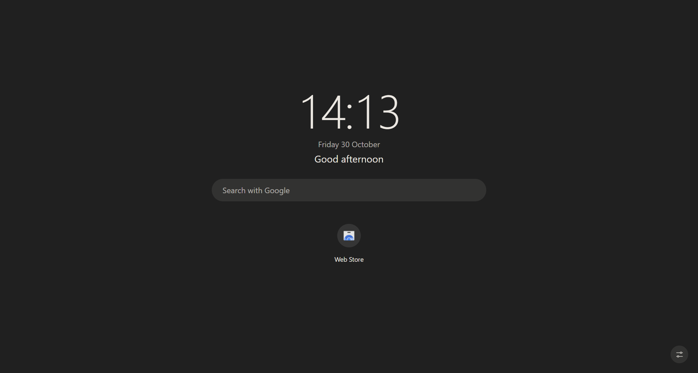
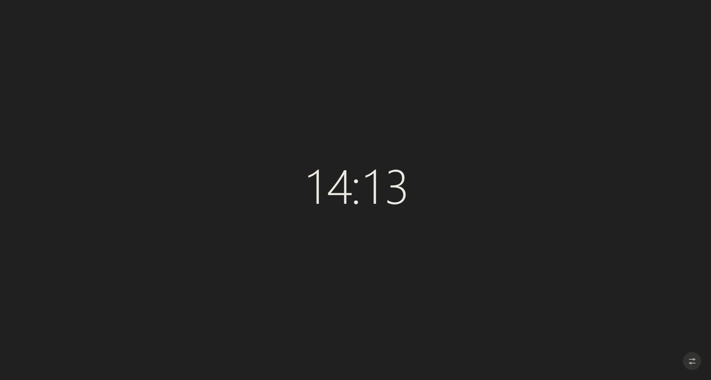

# Lyt

**A privacy-focused web browser for Windows, built on Chromium.** 
Pronounced "light". *Your browser. Your business.*

> **Status: early development.** Lyt is an experimental alpha being built now. There is no public download yet. This page shows what is being made; it is not the source code.

---

## What Lyt is

Lyt is a native desktop browser, a real fork of current Chromium rather than a skin over another browser. It aims to be private by default without needing hours of setup, while keeping the website compatibility and extension support people expect from a Chromium browser.

| | |
| --- | --- |
| **Private by default** | Third-party cookies blocked, Global Privacy Control on, link-click tracking pings off, no WebRTC local IP leaks, Google's advertising APIs off, no speculative preloading. |
| **Full uBlock Origin** | The complete uBlock Origin, not the "Lite" version, blocking trackers and hiding ads in Lyt's automated tests. |
| **Light on memory** | Memory Saver is on by default: idle tabs sleep, and wake when you return to them. |
| **Its own look** | Floating rounded tabs, a flat address bar, and four dark themes to choose from. |
| **Its own new-tab page** | Clock, date, search, shortcuts, optional private weather, and more. Everything is optional and stays on your PC. |
| **Honest about itself** | Lyt only claims protections it has tested, and says what it does not protect against. |

## A look at it

<table>
  <tr>
    <td width="50%"></td>
    <td width="50%"></td>
  </tr>
  <tr>
    <td align="center"><b>New-tab page.</b> Clock, date, greeting, search with your default engine and your shortcuts. Sleeping tabs, recently closed tabs, a quick note and weather can be switched on in the customise panel.</td>
    <td align="center"><b>Focus mode.</b> Press <kbd>F</kbd> on the new-tab page to hide everything but the clock.</td>
  </tr>
</table>

Screenshots are from a development build (30 October 2026) and show the first Graphite theme. They are test renders, not a finished design.

## Progress

**31 October 2026 (newest): first-run setup and a Shield widget are built.**

- **A Lyt welcome and setup flow** on first launch: an animated welcome, then your theme, your search engine (there is no silent default; your choice is applied when setup finishes), optional weather by town, and whether to make Lyt your default browser (you can skip it). A Done screen can open more options (startup pages, Memory Saver, new-tab widgets, favourites bar, import). If you quit part-way, setup comes back on the next launch.
- **Private setup.** A setup run makes no network requests; the automated tests check this at the test server. The search step only says "Lyt never sees your searches."
- **A Shield widget on the new-tab page** with Ring and Week views. It is wired to a data source that reports nothing yet, so today it only shows what the browser can confirm: whether third-party cookies are blocked and whether Global Privacy Control is on. It shows no numbers. Real counts come with the Lyt Shield, which is still to be built.
- **Tested.** The first-run flow, the More options screen and the Shield widget each have their own automated checks against the real build, and they pass. Nothing in these screens has been checked by eye yet.

<b>Earlier progress, 30 October 2026</b> (themes, privacy defaults, new-tab page, first build)

 

**Lyt now has four dark themes to choose from.**

- **Four themes.** Graphite (the default), Midnight, Obsidian and Forest. You pick one in Settings > Appearance.
- **The whole browser changes colour.** The window frame, tabs, toolbar, menus and address bar all follow the theme, and the change is instant, including in windows that are already open.
- **The new-tab page matches.** Lyt's own new-tab page recolours to suit, using the same single set of colours as the browser, so the two always agree.
- **A safe fallback.** If the setting ever holds a value Lyt doesn't recognise, it falls back to Graphite.
- **Tested.** The automated browser suite had 50 checks against the real compiled browser: 49 pass and one sound check is skipped because test browsers run muted. They include the new-tab page following the theme and the Settings picker saving your choice. A check built into the build process also fails the build if the browser's theme colours and the new-tab page's ever disagree. The themed look is still waiting for a hands-on review by eye.

**Google's ad-tracking APIs are switched off, plus two toolbar changes.**

- **Google's advertising APIs are off.** Topics, Fenced Frames and Attribution Reporting are switched off, so websites can't see or use them. Lyt's automated tests check this.
- **Extensions pin themselves to the toolbar** the first time they load. If you unpin one, it stays unpinned.
- **The tab search button now sits at the top right,** beside the window buttons.
- **Tested.** The suite had 46 checks at that point: 45 pass and one sound check is skipped because test browsers run muted. Lyt's themed right-click menus are built but have not been checked by eye yet.

**The first slice of Lyt's privacy defaults is built and tested.**

- **Global Privacy Control is on by default.** Every request carries the `Sec-GPC: 1` signal, and web pages see `navigator.globalPrivacyControl` as true, telling sites not to sell or share your data. The switch is in Settings > Privacy and security > Third-party cookies, and turning it off removes both signals.
- **Link-click tracking pings are off.** The hidden "ping" some links send to a third party when you click them is no longer sent.
- **WebRTC no longer reveals your local IP addresses** to websites.
- **HTTPS-First (balanced) is on,** and is now guarded by an automated test.
- **Tested.** The new checks failed on the previous build (no signal sent, a ping was sent, local IP addresses were exposed) and pass now.

**Lyt's own look and new-tab page are in the development build.** The first build looked too much like Chrome, so Lyt now has its own look and its own new-tab page, built into the browser:

- **A Lyt new-tab page.** A clock, date and greeting; search with your default search engine; your shortcuts; the tabs Memory Saver has put to sleep; recently closed tabs; a quick note; a focus mode (press F) that hides everything but the clock; and your own background image. A customise panel switches each of these on or off, and your settings stay on your PC.
- **Optional private weather.** Weather is off until you pick a town from a list of 34,193 towns that ships inside the browser, so nothing you type into the town search leaves your PC. Weather comes from MET Norway. Only the town's coordinates, rounded to about 1 km, are sent, at most once an hour, with no cookies and no referrer. Weather is the only part of the new-tab page that contacts a server.
- **A neutral dark look.** A plain dark-grey theme called "Graphite" runs across the browser and its settings pages. Lyt's orange appears only on things that are switched on (toggles, checkboxes, the main button and links). Floating rounded tabs and a flat, rounded address bar are also in the build.
- **Tested, but not yet reviewed by eye.** 65 unit tests passed at that point. The automated checks against the real compiled browser (Chromium 157) pass, including one full run with sound on that tests the playing-audio protection. The look is still waiting for a hands-on visual review, so it may change.

**The first real Lyt build is running.** It is built on Chromium 157 and passed all 12 of its first automated checks. These include:

- **Full uBlock Origin works.** It installs cleanly, blocks a tracker request before it leaves the browser, hides ads on the page, and runs alongside a modern (Manifest V3) extension.
- **Memory Saver is on by default.** An idle tab is put to sleep to free memory and comes back when you return to it. Tabs you are using are left alone: the one you are looking at, one playing audio, one using the camera, one with unsaved form input, and sites you have exempted.
- **Private defaults are in place.** Third-party cookies are blocked and page preloading is off. Search suggestions were off in that first build; the plan for everyday windows is below.

These are automated tests on a developer build. It is not a release, and it has not yet had a hands-on review or wider testing.

**Next up (planned, not built yet):**

- **Privacy Badger alongside uBlock Origin.** Work on bundling both has started, but Privacy Badger is not part of the tested build yet.
- **The Lyt Shield.** One place to see and control what each site can do, with real counts of what was blocked.

## Planned for the first alpha

- **Full uBlock Origin, built in.** The complete uBlock Origin, not the "Lite" version, ready from first launch, with its dashboard and element picker.
- **Privacy Badger, built in (planned).** EFF's tracker-learning blocker will sit alongside uBlock Origin, handling trackers that filter lists miss.
- **Private defaults.** Third-party cookies blocked. No speculative page preloading. Global Privacy Control on. No link-click pings. No WebRTC local IP leaks. Google's advertising APIs off. No usage telemetry. No account required. (The first slice of these is built; see Progress above.)
- **A convenient everyday window, a stricter Private window.** Search-as-you-type suggestions are planned to be on in the normal window, so Lyt is easy to use every day, and off in Private windows.
- **Memory Saver on by default.** Idle tabs release memory and reload when you return to them. You choose how aggressive it is and which sites are exempt.
- **A compact, dark interface.** A slim tab strip and toolbar that give the page more of the screen, with Lyt's own look and new-tab page (built; see Progress above).
- **Your extensions.** Chrome Web Store extensions are supported, and popular ones are tested individually.

## Further out

- **Lyt Shield:** one place to see and control what each site can do (cookies and storage, fingerprinting protection, "forget this site", and temporary fixes for broken sites).
- Stronger protection against cross-site tracking and fingerprinting, guided by measurement rather than marketing claims.
- **A Private window with Tor.** One switch to open a window routed through the Tor network, to hide your IP address without a VPN. It hides your IP address; it is not Tor Browser-level anonymity.
- An installer with signed, verified updates.
- **macOS and Linux.** Lyt is built for Windows first, with macOS and Linux planned afterwards.

## Principles

- **Honest claims.** Lyt will only claim the protections it has tested, and will say what it does not protect against.
- **Security first.** Chromium's sandbox, site isolation and certificate checks stay intact. Privacy is never bought by weakening security.
- **Local first.** No browsing data leaves your device for Lyt's benefit.

## Status

| Milestone | State |
| --- | --- |
| Product design and privacy feature research (120 items) | Done |
| Build tooling and pinned Chromium source | Done |
| First native build | Done: passes its automated checks |
| Lyt's own look (floating tabs, flat address bar) | Built and passing automated tests; awaiting a hands-on visual review |
| Four dark themes (Graphite, Midnight, Obsidian, Forest), chosen in Settings > Appearance | Built and passing automated tests; awaiting a hands-on visual review |
| Lyt new-tab page, with optional private weather | Built and passing automated tests; awaiting a hands-on visual review |
| Privacy defaults, first slice (Global Privacy Control, no link pings, no WebRTC local IPs, HTTPS-First, Google ad APIs off) | Built and passing automated tests |
| Welcome and setup flow, and a Shield widget on the new-tab page | Built and passing automated tests; not yet checked by eye |
| Privacy Badger bundled | Planned (work started) |
| Lyt Shield (per-site controls and real counts) | Planned |
| Usable developer alpha | Not yet |
| Public download | Not yet |

## Credits

Lyt is built on [Chromium](https://www.chromium.org/) by The Chromium Authors. It bundles [uBlock Origin](https://github.com/gorhill/uBlock) by Raymond Hill and contributors, and plans to bundle [Privacy Badger](https://privacybadger.org/) by the Electronic Frontier Foundation. Both are GPL-3.0 projects and are credited under their own licences. Their inclusion does not imply endorsement by their authors.

Weather in the optional new-tab weather comes from [MET Norway](https://api.met.no/). Town names come from [GeoNames](https://www.geonames.org/) (CC BY 4.0).

## Licence

Lyt is **not open source**. Copyright (c) 2026 the Lyt author. All rights reserved. See [LICENSE.md](LICENSE.md).
